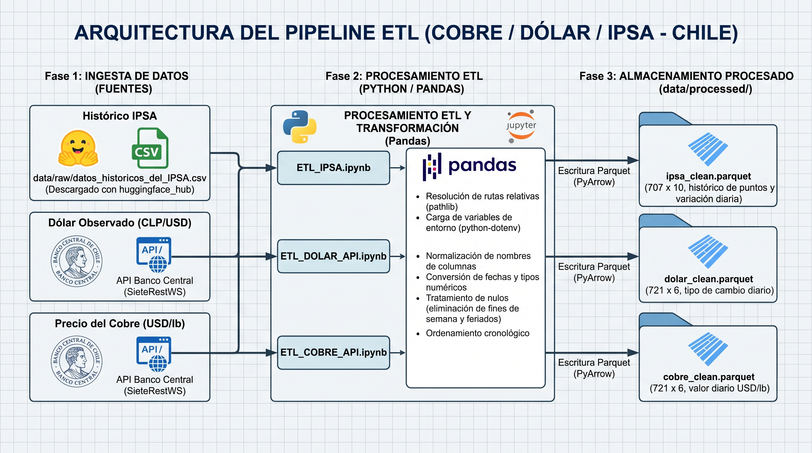
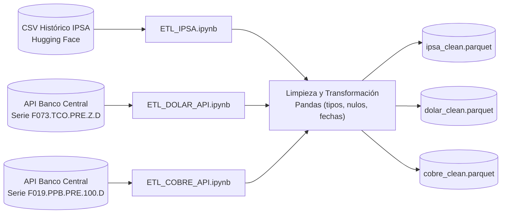

# ETL Cobre, Dólar e IPSA — Chile

<p align="left">
  
  
  
  
</p>

Pipeline ETL (Volumen 1) orientado a modelar la relación económica entre el precio del **cobre**, el **dólar observado (USD/CLP)** y el índice bursátil **IPSA** en Chile. Está organizado bajo la metodología **Cookiecutter Data Science** con un notebook modular por fuente de datos y salidas en formato columnar **Parquet**.

---

## Arquitectura del Flujo





---

## Fuentes de Datos y Resultados

| Fuente | Origen / Serie | Notebook ETL | Salida Parquet | Dimensiones | Rango Temporal | Nulos / Duplicados |
| :--- | :--- | :--- | :--- | :---: | :---: | :---: |
| **IPSA** | CSV en Hugging Face (`DVidelaS/historico_ipsa_chile`) | `src/data/ETL_IPSA.ipynb` | `ipsa_clean.parquet` | 707 × 10 | 2024-01-19 a 2026-11-20 | 0 / 0 |
| **Dólar Observado** | API Banco Central (`F073.TCO.PRE.Z.D`) | `src/data/ETL_DOLAR_API.ipynb` | `dolar_clean.parquet` | 721 × 6 | 2024-01-02 a 2026-11-23 | 0 / 0 |
| **Cobre** | API Banco Central (`F019.PPB.PRE.100.D`) | `src/data/ETL_COBRE_API.ipynb` | `cobre_clean.parquet` | 721 × 6 | 2024-01-02 a 2026-11-23 | 0 / 0 |

*Nota de calidad:* Los valores `NaN` originales en las series del Banco Central corresponden a fines de semana y feriados bancarios, por lo que se eliminan de forma justificada sin imputación artificial. En el IPSA se descarta la columna `Vol.` por estar 100% vacía.

---

## Diccionario de Datos (Salidas Parquet)

* **Variables temporales comunes (los 3 datasets):** `fecha` (`datetime64`), `anio` (`int`), `mes` (`int`), `dia` (`int`), `dia_semana` (`string`).
* **IPSA (`ipsa_clean.parquet`):** `ultimo`, `apertura`, `maximo`, `minimo` (puntos del índice, `float64`) y `porcentaje_variacion` (variación diaria en %, `float64`).
* **Dólar (`dolar_clean.parquet`):** `dolar_observado` (pesos chilenos por dólar, CLP/USD, `float64`).
* **Cobre (`cobre_clean.parquet`):** `cobre_observado` (precio del cobre refinado, USD/lb, `float64`).

---

## Estructura del Proyecto

```text
.
├── data/
│   ├── raw/                        # CSV original del IPSA descargado desde Hugging Face
│   ├── interim/                    # Datos intermedios
│   └── processed/                  # Salidas limpias en Parquet
│       ├── ipsa_clean.parquet
│       ├── dolar_clean.parquet
│       └── cobre_clean.parquet
├── docs/
│   └── captures/
│       └── 00_arquitectura.jpeg    # Diagrama de arquitectura del pipeline
├── notebooks/                      # Reservado para EDA (Volumen 2)
├── src/
│   ├── data/
│   │   ├── ETL_IPSA.ipynb          # Ingesta y limpieza del IPSA
│   │   ├── ETL_DOLAR_API.ipynb     # Ingesta vía API BCCh y limpieza del Dólar
│   │   └── ETL_COBRE_API.ipynb     # Ingesta vía API BCCh y limpieza del Cobre
│   └── models/                     # Reservado para modelamiento (Volúmenes 3 y 4)
├── .env.example                    # Plantilla de variables de entorno
├── project_context.md              # Documentación detallada del proyecto
├── requirements.txt                # Dependencias fijadas
└── README.md
```

---

## Configuración y Ejecución

### 1. Instalar dependencias
Requiere **Python 3.12 o superior**.

```bash
python3 -m venv venv
source venv/bin/activate
pip install -r requirements.txt
```

### 2. Configurar variables de entorno
Copia la plantilla `.env.example` a `.env` y completa tus credenciales de la API del Banco Central de Chile:

```bash
cp .env.example .env
```

```dotenv
IPSA_DATASET_URL=[https://huggingface.co/datasets/DVidelaS/historico_ipsa_chile/resolve/main/datos_historicos_del_IPSA.csv](https://huggingface.co/datasets/DVidelaS/historico_ipsa_chile/resolve/main/datos_historicos_del_IPSA.csv)

DOLAR_API_BC_URL=[https://si3.bcentral.cl/SieteRestWS/SieteRestWS.ashx](https://si3.bcentral.cl/SieteRestWS/SieteRestWS.ashx)
DOLAR_API_BC_TOKEN=tu_token_bcch

COBRE_API_BC_URL=[https://si3.bcentral.cl/SieteRestWS/SieteRestWS.ashx](https://si3.bcentral.cl/SieteRestWS/SieteRestWS.ashx)
COBRE_API_BC_TOKEN=tu_token_bcch
```

### 3. Ejecutar los notebooks ETL
Abre y ejecuta cada notebook en `src/data/` con **Restart & Run All**:
1. `ETL_IPSA.ipynb`
2. `ETL_DOLAR_API.ipynb`
3. `ETL_COBRE_API.ipynb`

Cada notebook resuelve rutas con `pathlib`, valida las respuestas y guarda su archivo `.parquet` de forma atómica en `data/processed/`.

---

## Próximos Pasos (Roadmap)

* **Volumen 2:** Alineación temporal (intersección de días hábiles) y Análisis Exploratorio de Datos (EDA).
* **Volumen 3:** *Feature Engineering* y preparación de series para modelamiento.
* **Volumen 4:** Modelamiento predictivo, evaluación e interpretación.